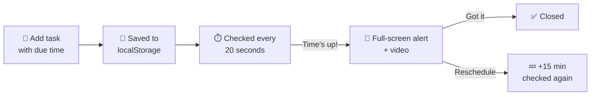

<div align="center">

# 📒 Ledger — Task Tracker

**A clean, browser-based to-do list that refuses to let you forget a deadline.**


</div>

---

### ✨ What is Ledger?

Ledger is a simple to-do list that lives entirely in your browser. Type a task, optionally set a
due date/time, and Ledger will track it for you. When the due time hits, a **full-screen alert with
video** pops up so the task is impossible to miss.

No sign-up. No server. No database. Just `index.html` + `style.css` + `script.js`.

<div align="center">


</div>

---

## 🚀 Features

| | Feature | Description |
|---|---|---|
| ➕ | **Add tasks** | Type a task and (optionally) set a due date/time |
| ✅ | **Mark complete** | One click to check a task off |
| ✏️ | **Inline editing** | Click the pencil, edit the text, click again to save |
| 🗑️ | **Delete** | Remove a task instantly |
| 🧹 | **Clear completed** | Wipe all finished tasks in one click |
| ⏰ | **Deadline alerts** | Full-screen popup + video when a task is due |
| 💤 | **Snooze** | Push an overdue task 15 minutes ahead |
| 💾 | **Auto-save** | Everything persists via `localStorage` — refresh-proof |
| 🎨 | **Color-coded urgency** | Tasks glow orange when due soon, red when overdue |

---

## 🗂️ Project Structure

```
📁 ToDoList/
├── 📄 index.html         → page layout (form, task list, alert popup)
├── 🎨 style.css           → all visual styling
├── ⚙️ script.js           → all app logic (see below)
└── 📁 videos/
    ├── video4.mp4        → reminder alert video (1st in sequence)
    └── video6.mp4        → reminder alert video (2nd in sequence)
```

> ⚠️ Keep the `videos/` folder next to `index.html` — the alert popup expects
> `videos/video4.mp4` and `videos/video6.mp4` to exist.

---

## 🔔 How the reminder system works



1. You give a task a due date/time.
2. Ledger saves your whole list to the browser (`localStorage`) so it survives refreshes.
3. A background timer checks all tasks **every 20 seconds**.
4. The instant a task's time has passed, Ledger shows a big alert with the task name and plays a video.
5. You either dismiss it (**"Got it"**) or push it back 15 minutes (**"Reschedule"**).

If several tasks are due around the same time, alerts play **one after another**, never stacked.

---

## ⚙️ Function reference (`script.js`)

<details>
<summary><strong>💾 Saving & loading</strong></summary>

| Function | What it does |
|---|---|
| `saveTasks()` | Writes the current task list into `localStorage` |
| `loadTasks()` | Reads the saved list back out on page load |

</details>

<details>
<summary><strong>🖼️ Rendering the list</strong></summary>

| Function | What it does |
|---|---|
| `render()` | Redraws every task row — text, buttons, urgency color |
| `fmtWhen()` | Turns a raw date into a friendly string ("Aug 12, 3:30 PM") |
| `urgency()` | Decides if a task is `none`, `scheduled`, `due-soon`, or `overdue` |
| `updateMeta()` | Updates the "X open · Y done" counter and empty-state message |
| `placeCaretAtEnd()` | Keeps your cursor at the end of the text while editing |

</details>

<details>
<summary><strong>✏️ Changing tasks</strong></summary>

| Function | What it does |
|---|---|
| `addTask(text, when)` | Creates and stores a new task |
| `toggleComplete(id)` | Flips a task between done / not done |
| `removeTask(id)` | Deletes a task permanently |

</details>

<details>
<summary><strong>🚨 Alerts & reminders</strong></summary>

| Function | What it does |
|---|---|
| `checkDeadlines()` | Runs every 20s — finds overdue, unfinished, un-alerted tasks |
| `playNextAlert()` | Shows the popup for the next due task |
| `playReminderSequence()` | Plays the reminder videos back-to-back |
| `closeAlert()` | Hides the popup and shows the next queued alert, if any |

</details>

---

## 📝 Notes

- Tasks are stored **only in your browser** — clearing browser data erases them, and they won't sync across devices.
- Alerts can appear up to ~20 seconds after the exact due time (that's the check interval, not a bug).
- Want it hosted? Just open `index.html` in a browser, or serve the folder with GitHub Pages.

<div align="center">

**Made with 🕒 and a mild fear of forgetting things.**

</div>


